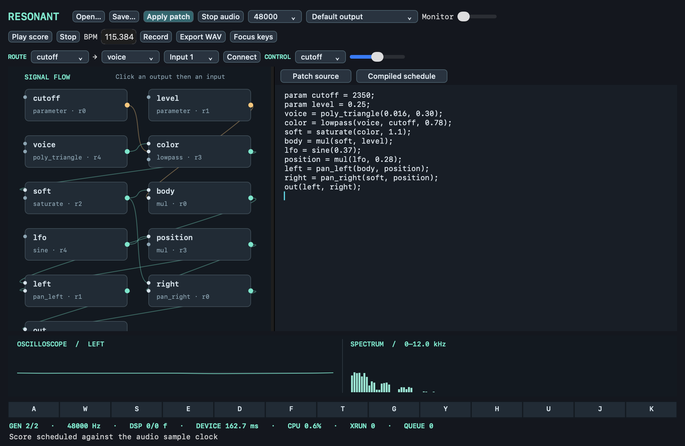

# Resonant

Resonant is a programmable stereo instrument. A patch becomes typed, bounded DSP bytecode. The same C++23 engine plays it on an audio device, renders a score offline, and publishes verified edits while notes are running.



[Compact workbench](docs/media/workbench-compact.png) · [Architecture](docs/ARCHITECTURE.md) · [Diagrams](docs/diagrams/README.md) · [Current limits](docs/BUILD_STATUS.md)

## Play a patch

Build with CMake 3.25+, a C++23 compiler and Make. Use Python 3.11+ for the diagnostics and gallery. macOS uses AppKit for the workbench. Install PortAudio 19.7 with Homebrew for hardware playback on macOS.

```sh
make test
make demo
make workbench
```

In the workbench, click **Start muted**, then **Play score** or **Focus keys** and play A W S E D F T G Y H U J K. Raise **Monitor** to hear the output. Select a Core MIDI source in **MIDI Off** to play from an external controller or a virtual source. Click an output port and then an input, or use the route controls. **Apply patch** compiles edits in the source pane. An invalid edit shows a source diagnostic and leaves the running graph intact. The schedule pane shows rates, bytecode operations and physical register lifetimes.

```text
param cutoff = 1800;
keys = poly_triangle(.01, .25);
tone = lowpass(keys, cutoff, .8);
room = convolve_short(tone, .30);
level = mul(room, .24);
out(level);
```

Use **Import IR…** to embed a short WAVE impulse and reference it from `convolve_ir(signal, mix, ir1)`. The CLI works offline on macOS and Linux. `make demo` writes `out/ember-motif.wav` and disassembles the verified patch. `make patch-gallery` renders each instrument and all six compositions with checksums. The gallery includes aligned convolution sends, an explicit feedback echo, a sustain-pedal piece and a tempo-changing automation piece.

## Inspect the machine

- [Patch source, bytecode and scheduling](docs/SPECIFICATION.md)
- [Callback ownership, events and publication](docs/REALTIME.md)
- [Synthesis, dynamics and latency](docs/DSP.md)
- [Numerical experiments](docs/EXPERIMENT_PLAN.md) and [reproduction](docs/REPRODUCE.md)

```sh
make compile-patch verify-bytecode
build/resonant inspect patches/reference-64.rpatch
make dsp-check
make stress
```

The native engine and CLI are available as a preview. The short hardware measurements cover a 64-voice stereo patch with two filters, two convolution paths and two limiters. Full eight-hour hardware and offline qualification is pending. See the [build status](docs/BUILD_STATUS.md) for scope and measured limitations.
